<p align="center">
  
</p>

<h1 align="center">Vellum</h1>

<p align="center">
  Upload old building drawings, scans and photos. Get counts, areas and answers you can check on the plan, each
  with how sure it is.
</p>

<h3 align="center">
  <a href="https://junction.hour49.com">Try the live demo: junction.hour49.com</a>
</h3>

<p align="center">
  <sub>You don't need an account. Without an access code you get a click-through demo on real drawings. With a
  code you get the full app and can upload your own files.</sub>
</p>

<p align="center">
  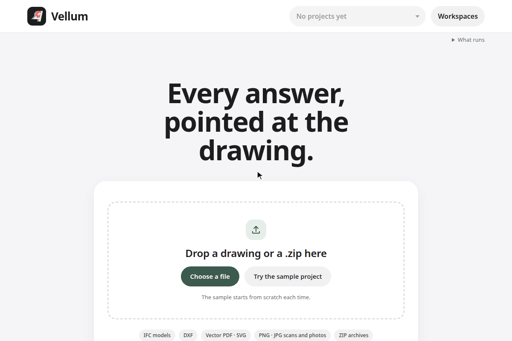
</p>

<p align="center">
  <sub>The real app on a local production build of main: upload a scan, ask in the chat, see the marks on the plan
  beside it, open a place the readers disagree on. The wait for the reading is shortened in the GIF.<br>
  Plan: Isaac Franklin House, Historic American Buildings Survey, Library of Congress, public domain
  (<a href="#credits-and-licences">full credit</a>).</sub>
</p>

Vellum is team Hour49's entry for the Stoa challenge at Junction 2026 (Espoo, 13 to 15 November 2026). Stoa asks
for answers to questions about construction drawings and building models, with proof of where each answer came
from.

## What it does

- It reads drawn PDFs, IFC building models and images: scans, photos of paper plans, PNG, JPEG, TIFF or WebP
  exports. A zip of a whole project works too. A file that is not a drawing is set aside with a reason and kept.
- A question in plain words (11 languages) gets a value with its unit, numbered marks on the plan for everything
  that was counted, the method that produced it, and the cost and time of the answer.
- Every answer is rated High, Medium or Low, and each level states how often answers rated that way were exact on
  our validation plans. A model's score is never shown as a percentage.
- When the readers disagree about a mark, the answer says which mark and why, and a person confirms it or fixes
  it.
- If a sheet could not be read, or the question is not something it can measure, it says "I don't know" and gives
  the reason instead of guessing.
- The chat can edit a plan: "remove the wall between the bathroom and the bedroom", or drag a box and say "put a
  storage room here". Geometry code computes the new rooms and areas, and the change is checked against a few
  building rules for Finland or the Canton of Zürich before anyone accepts it.
- With the building's plumbing, ventilation and heating models (IFC), Vellum follows every plan edit through them:
  the answer lists the pipes and ducts on a removed wall and the radiators or vents that would lose their
  connection. The chat can also say what feeds a radiator and propose moving, adding or removing one, drawn on
  the storey before and after. A scan or photo of a heating, plumbing or ventilation sheet is read too: a Gemini
  model reads its legend and symbols, and when the sheet's walls match the plan's, it is laid over the plan so an
  edit shows on it. Answers from such a sheet are always Low.
- A question the drawing's quantities do not cover can be answered from what an IFC model states (its fact
  sheet), marked Low because those answers are not measured yet. An IFC file also opens in a 3D view.

## A look at the app

Every picture below is the real app, run from a production build of main with the demo settings on 14 November.
Since then the screens have moved to shadcn/ui components and the chat lists the project's files beside it, so
today's app looks a little different. The pictures use two drawings: a scanned sheet from the Historic American Buildings
Survey, and a three-room flat we drew ourselves as a vector PDF.

### An answer you can check

A drawn PDF and a scan are read in different ways. From the drawn PDF the answer is High: the reader works from
the vectors, and on our reference drawings of that kind 794 of 794 answers were exact.

<p align="center">
  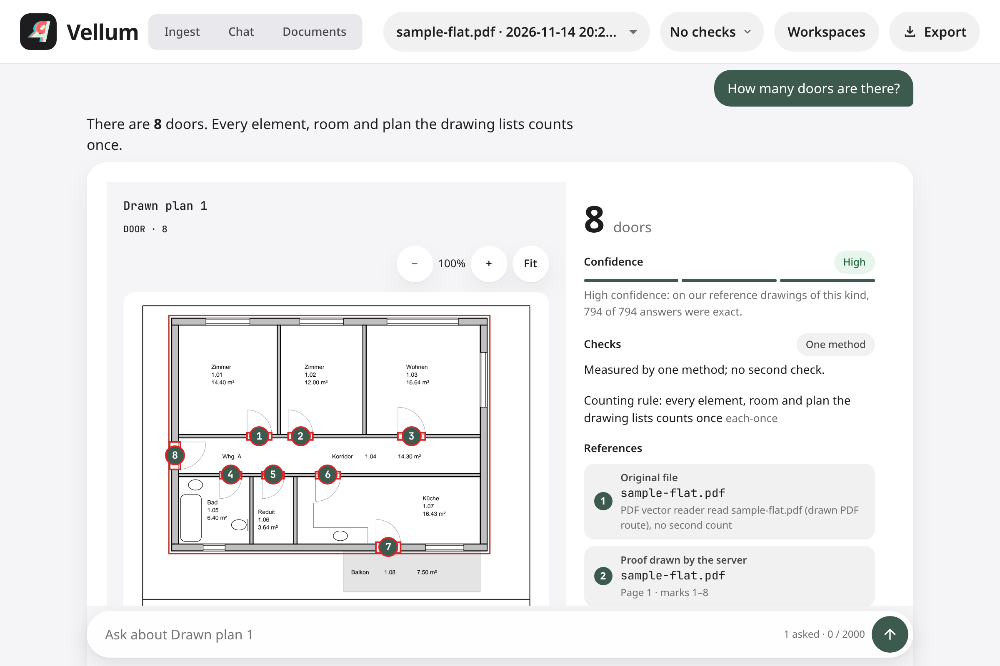
</p>
<p align="center"><sub>Plan: our own sample flat, drawn by code.</sub></p>

A scan is harder. On this sheet from 1973 the image reader counts 19 doors and rates the answer Low. At three
places one of the two second readers does not agree with it, so the card names each place and asks a person to
look. The toilet count on the same sheet is High: a second reader, a Gemini model that reads the sheet on its own,
counted the same.

<p align="center">
  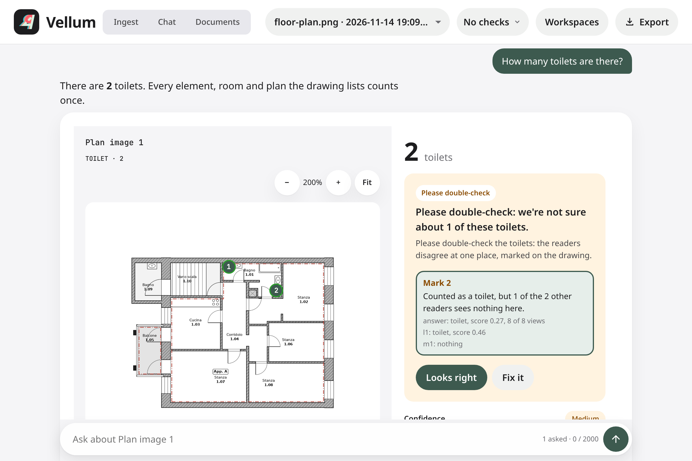
</p>
<p align="center"><sub>Plan: Isaac Franklin House, Historic American Buildings Survey, Library of Congress, public domain.</sub></p>

### A refusal that says why

Sheet A101 of a real house project (OpeningDesign, CC BY-SA 4.0; the sheet itself is not shown) is drawn in a style
the PDF reader has no rules for, so nothing was read from it. Asked about it, Vellum says so.

<p align="center">
  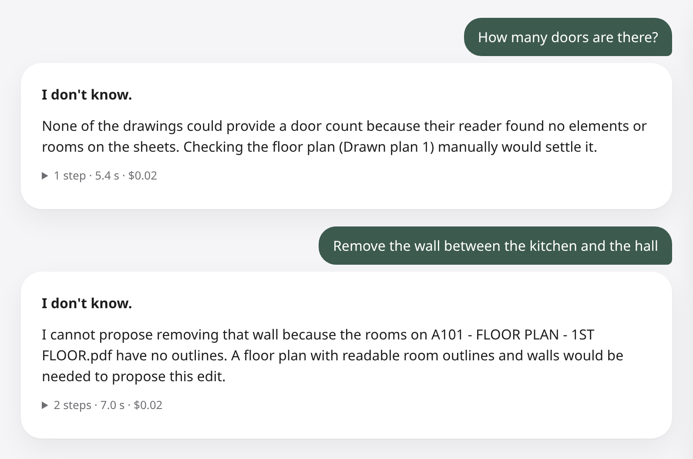
</p>

### The agent chat: edit the plan, check the rules

The chat is an agent that calls the same tools the app uses. It picks walls and rooms by id and never writes a
coordinate or a number itself: geometry code works out the new outline and the areas. With a key the tools are
driven by a Gemini model, as in these pictures; without one, keyword rules choose the tools. To point at the plan,
the pen turns on draw mode: click a room or drag a box. On a scan or photo the pen is greyed out and says why,
since their walls are pixels. Here a box is dragged over part of a bedroom and the agent is asked for a storage
room. The bedroom drops from 12.00 to 8.76 m², which would not meet the Canton of Zürich's
10 m² minimum, and the card says so and quotes the clause.

<p align="center">
  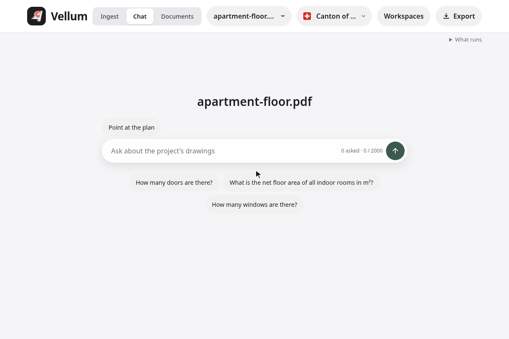
</p>
<p align="center"><sub>Plan: our own sample flat, drawn by code.</sub></p>

An edit is a proposal: the drawing file is not changed, and a person accepts or rejects it. What the drawing does
not say stays unknown, such as whether a wall carries load. Each turn lists the steps the agent took. The rule
check covers a few rules and is not a permit check.

<p align="center">
  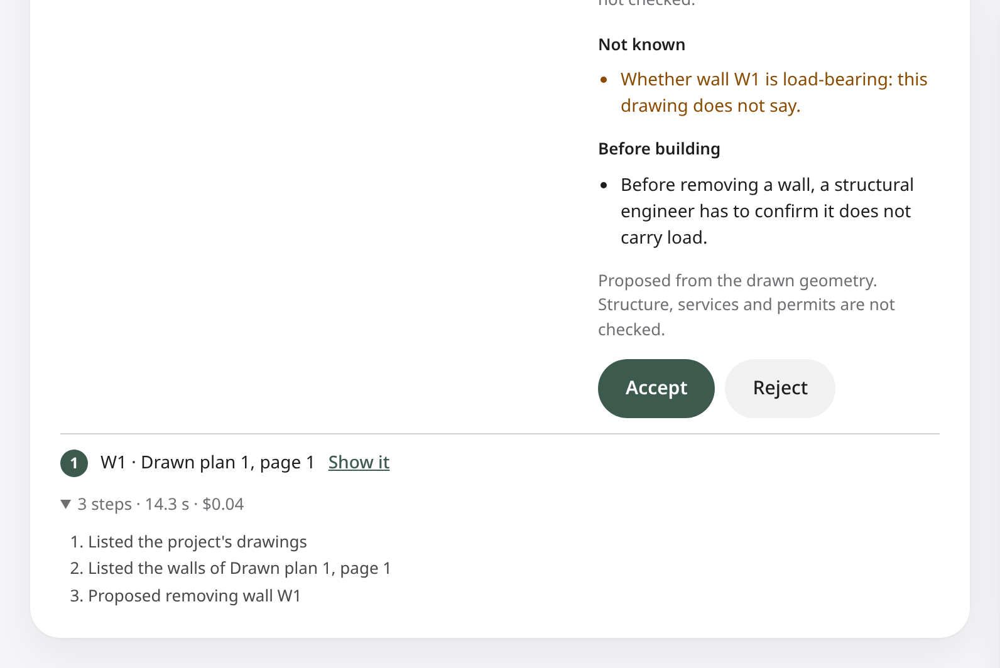
</p>

### Sign-off, and on a phone

A surveyor gets every quantity of a drawing as a table to review, sign off and export as CSV.

<p align="center">
  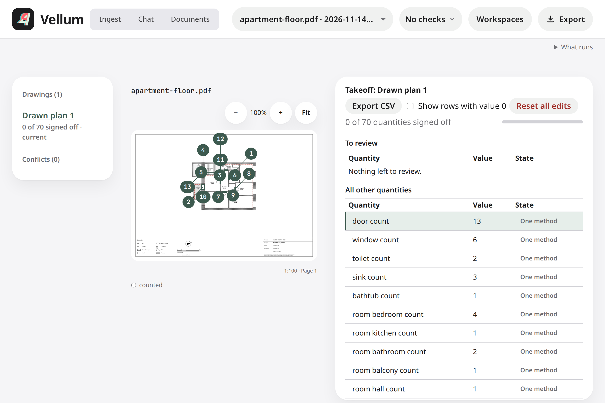
</p>
<p align="center"><sub>Plan: our own sample flat, drawn by code.</sub></p>

The same screens at phone width:

<p align="center">
  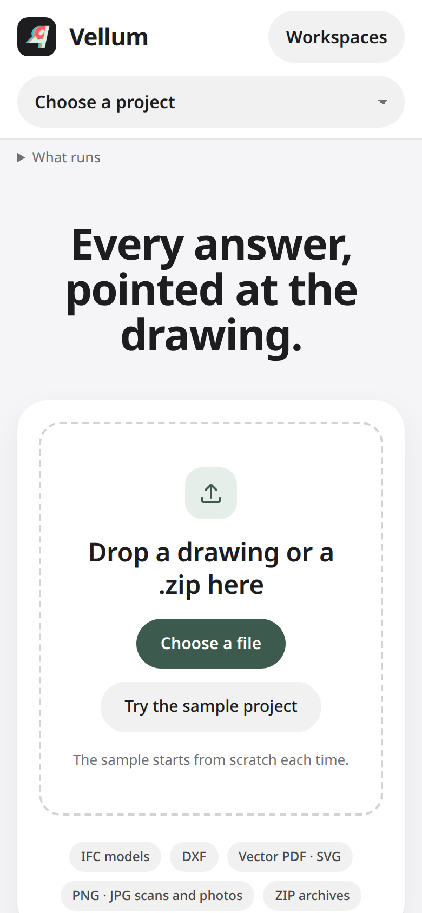&nbsp;
  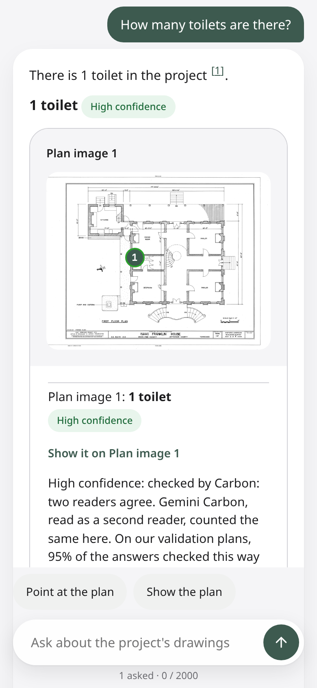&nbsp;
  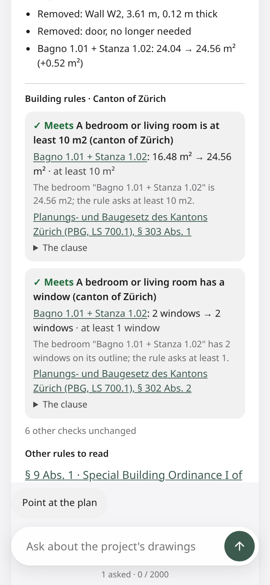
</p>
<p align="center"><sub>Plans in the two phone pictures: Isaac Franklin House, Historic American Buildings Survey, Library of Congress, public domain (middle); our own sample flat, drawn by code (right).</sub></p>

## How it works

All the drawing work happens once, when a file is uploaded. The result is a drawing model: one JSON file per plan
holding every element and room with its place on the page, and every quantity already counted. A question asked
later is a lookup in that model, with no model call, so it costs almost nothing and gives the same answer every
time.

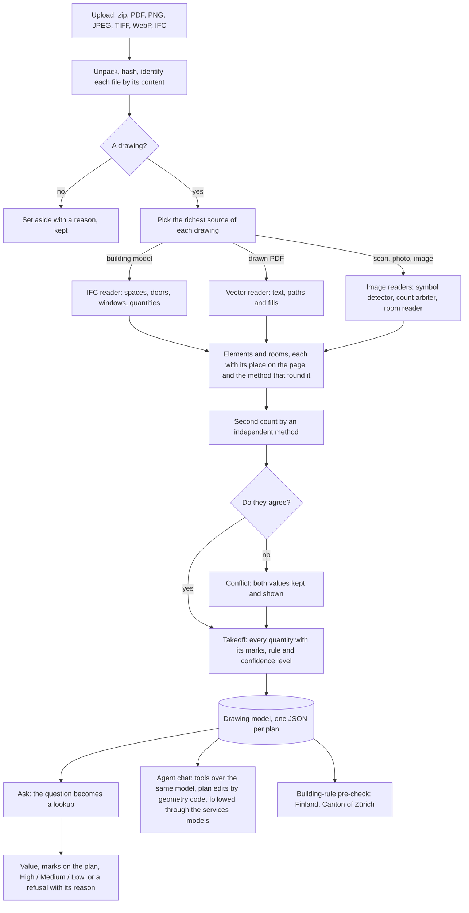

An IFC model is read through its own objects, a drawn PDF from its vectors, and an image by detectors and a room
reader. Images are the hard case, so most of the Medium and Low answers and most of the double-check requests
come from that route.

Where it can, Vellum counts twice: a sheet against its IFC model, a printed scale against the scale bar, a printed
room area against the measured outline. When the two differ, it shows both.

The thresholds behind High, Medium and Low were fixed on validation plans and written down before the test
numbers were computed.

The backend is ports and adapters. Every reader is one adapter chosen by a setting, so a reader can be swapped or
switched off without touching the rest. The settings the live demo runs with, and the readers we left off on
purpose with what we measured, are in [docs/PIPELINE.md §4](docs/PIPELINE.md#4-settings-the-demo-config-and-what-stays-off).

The full pipeline with every stage and what it writes: [docs/PIPELINE.md](docs/PIPELINE.md). The API:
[docs/API.md](docs/API.md). Why each decision was made: [docs/decisions/](docs/decisions/README.md).

## What we measured

Stoa's own scoring: a count must be exact, and an area, length or volume must be within 2%. A missing answer counts
as wrong.

| What | Result | What it means |
| --- | --- | --- |
| The whole pipeline on our golden set, 2,948 Stoa questions on a fixed set of drawings | 2,749 right (93.2%); 95.0% on the holdout questions; 3.8% abstained | Files in, answers out, in the demo settings, run from a clean export of commit 030abbb. The holdout questions come from the 20% of the dataset we sealed and never tuned on. |
| Room areas on the golden set's CubiCasa images | 57 of 82 within 2% | Up from 9 of 82 once an area printed in a room's label is read as that room's area. |
| Plan images, 376 CubiCasa test pages read once | 87.0% exact (5,846 of 6,718) | The image route alone. Always answering with the most common answer gets 56.3%. |
| Confidence levels on those test pages (3,359 answers) | High: 37.9% of answers, 99.0% exact. Medium: 41.1%, 92.8% exact. Low: 21.0%, 54.2% exact | The level tells you how far to trust the answer. Windows are always Low, and 55.9% of those answers are exact. |
| Double-check requests on those test pages | 97.0% of the wrong answers flagged (846 of 872); 98.98% of the unflagged answers exact | The price is that it asks about 62.1% of all answers, so a person also reviews many right ones. |
| Sheet against IFC model | All 14 conflicts in the golden set found, no false alarm on 102 agreeing entries | For example a window above the 1.20 m cut that the model has and the sheet does not draw. |
| Drawn Swiss plans, all dataset questions | Counts 25,562 of 25,568; areas 12,012 of 12,016 | The reading rules were fitted on the same questions, so this is not a held-out result. |

The golden score over the event, each point a clean run of a merge commit: 0% (Friday 23:24, nothing read yet),
42.8% (23:55, drawn PDFs), 74.7% (Saturday 01:43, IFC models added), 91.6% (04:56, the image route added), 93.2%
(19:34), 93.2% (Sunday 00:41, after the evening's merges; no golden answer changed).

Method, per-family tables and every run: [docs/GOLDEN.md](docs/GOLDEN.md). What we tried on the image route and
what it gave: [docs/EXPERIMENTS.md](docs/EXPERIMENTS.md). All numbers with their caveats:
[docs/PRODUCT.md](docs/PRODUCT.md#numbers).

## Limits

- Sketches: we claim no door counting on hand-drawn plans. On 14 hand-drawn sheets the door count was in range on
  0 of the 10 that have doors.
- On an image, areas come from an estimated scale unless a printed scale can be measured. They are labelled as
  estimates and can be far off. The estimate comes from the doors, so a scan with no door found and no readable
  scale gets no areas at all.
- Windows on images stayed at about 45 to 55% in every approach we tried.
- A drawn PDF in a style the vector reader has no rules for is flagged and its questions are refused, as in the
  refusal above.
- Plan edits need a drawn plan. A scan's walls are pixels, and the agent says so.
- Services drawn on a scan or photo are read by a Gemini model, and every answer from them is Low. On one held-out
  building rendered from its models it found 92% of the symbols, but no real scanned services sheet has been
  scored. A pipe run's length read from its line colours is an estimate: within 10% on 18 of 32 clean renders and
  none of 32 scans.
- Answers from an IFC model's fact sheet are not measured on any gold yet, so they are always Low.
- The building-rule pre-check covers a few rules, in Finland and the Canton of Zürich only.
- There is no login. The live demo sits behind a shared access code.

The full list: [docs/PRODUCT.md](docs/PRODUCT.md#limits) and [docs/KNOWN.md](docs/KNOWN.md).

## Run it

You don't need any keys to run it. Without them the vector PDF and IFC readers run and the rest use do-nothing
stand-ins, so `GET /api/info` says `no_keys: true`. You need Python 3.13 with uv, and Node 24 for the frontend.

```bash
# backend (http://127.0.0.1:8000)
cd backend && uv sync --locked
uv run python scripts/make_sample_archive.py     # the synthetic sample project, into data/samples/ (gitignored)
uv run uvicorn app.main:create_app --factory

# frontend (second terminal; /api goes to BACKEND_URL, default http://127.0.0.1:8000)
cd frontend && npm ci && npm run build && npm run preview     # http://127.0.0.1:4173
```

On the home page, "Try the sample project" ingests the synthetic archive: 12 files, six drawings, no partner
data. With no keys, 4 files are ready, 4 flagged, 2 set aside and 2 text only; plans/flat-c.pdf is the sheet
you can draw an edit on. Last verified on 2026-11-15 (offline tests, branch demo/sample-walled).

A Gemini key (`GEMINI_API_KEY`) turns on the readers that need a model: rooms on images and photos, the count
distributions behind the confidence, large or hard sheets, and the printed scale. `EU_VLM_*` sets an EU open
model as the alternative. Keys go only in the gitignored `backend/.env` (template: `backend/.env.example`).
`GEMINI_BUDGET_USD` caps the spend, and `0` refuses every Gemini call.

The vector PDF reader, the IFC reader, the second count and the question parser run locally with no key. So do
the detectors when their weights are in `data/models`; the weights are not in this repo (see the credits).

`tools/qa-env.sh <commit> [port] --frontend` exports a commit and runs it with the settings the live demo uses;
`tools/qa-env.sh config` prints them, and [docs/PIPELINE.md §4](docs/PIPELINE.md#4-settings-the-demo-config-and-what-stays-off)
says what each one does. Two things are built ahead for the demo, in `backend/`: the services models the chat's
services tools read (`uv run python -m app.cli services build`; a model not built ahead is built when a chat turn
first needs it, and the tools say so until it is ready) and the 3D views (`uv run python -m app.cli glb`; without it
the first view converts on demand, 4 to 52 s on our models).

Guides: [backend/README.md](backend/README.md), [frontend/README.md](frontend/README.md),
[eval/README.md](eval/README.md). The golden path a release is checked against: [docs/QA.md](docs/QA.md).

## Where things are

| Path | What |
| --- | --- |
| `backend/` | Python 3.13, FastAPI. `app/core` is the pure pipeline, `app/adapters` the readers and outside services. |
| `frontend/` | React, Vite, TypeScript, shadcn/ui components on Tailwind, light theme only. The app in the pictures above. |
| `eval/` | The scorer, the sealed split, the golden set and every recorded run. |
| `site/`, `demo/` | The access gate in front of the live demo, and the click-through demo it serves without a code. |
| `docs/` | [Product](docs/PRODUCT.md), [pipeline](docs/PIPELINE.md), [golden set](docs/GOLDEN.md), [eval in short](docs/EVAL.md), [experiments](docs/EXPERIMENTS.md), [API](docs/API.md), [decisions](docs/decisions/README.md), [engineering standard](docs/ENGINEERING.md), [QA](docs/QA.md). |
| `tools/`, `templates/` | The agent setup the team works with: [docs/AGENT-SETUP.md](docs/AGENT-SETUP.md). |
| `junction-pitch/` | Pitch kit and research: [junction-pitch/README.md](junction-pitch/README.md). |

## Team

Hour49, at Junction 2026, on the Stoa challenge: [Bogzx](https://github.com/Bogzx),
[Cucuteanu-Tudor-912](https://github.com/Cucuteanu-Tudor-912), [bbeatricecretu](https://github.com/bbeatricecretu)
and [madabotos](https://github.com/madabotos).

Each of us ran a Claude Code orchestrator with a few worker agents, and the orchestrators talked to each other
through GitHub issues in this repo. That tooling was written before the event, and we declare it in the
submission form.
How it works: [docs/TEAM-AGENTS.md](docs/TEAM-AGENTS.md).

## Credits and licences

The code is MIT licensed, see [LICENSE](LICENSE).

The scan in the pictures is sheet 2 of 6 of the Historic American Buildings Survey record of the Isaac Franklin
House, U.S. Route 25 East, White Pine, Jefferson County, Tennessee: survey HABS TN-197, Library of Congress call
number HABS TENN,45-WHIP,1- (sheet 2 of 6). The sheet's title block names its draftsman, Stephen Fildes, and the
Survey's East Tennessee Project of 1973. Credit: Historic American Buildings Survey, National Park Service; Library
of Congress, Prints and Photographs Division,
[record of the sheet](https://www.loc.gov/pictures/item/tn0085.sheet.00002a/). The sheet was drawn under the direction
of the National Park Service, as its title block states. As a work of the U.S. federal government it is in the
public domain, and the credit is a courtesy. We took the Library's
[master scan](https://tile.loc.gov/storage-services/master/pnp/habshaer/tn/tn0000/tn0085/sheet/00002a.tif) and
scaled it down to 3000 pixels wide. Our screenshots add the app's marks and overlays.

The drawn plan in the pictures is our own: a three-room flat that
[tools/readme-media/make_plan.py](tools/readme-media/make_plan.py) draws as a vector PDF, in the drawing conventions
the vector reader has rules for. It is under this repo's MIT licence.

The house sheet in the refusal example comes from the public repositories of
[OpeningDesign](https://github.com/OpeningDesign/New_2nd_Story), Madison, Wisconsin, and the project team named in
each title block, [CC BY-SA 4.0](https://creativecommons.org/licenses/by-sa/4.0/). No picture here shows it.

Stoa's dataset is partner data for the challenge. None of it is in this repo or in a picture here, and the scripts
that fetch it keep it in a gitignored folder. Its drawn Swiss plans, which the vector reader's rules were fitted on,
come from Swiss Dwellings v3.0.0 (Archilyse AG, [doi:10.5281/zenodo.7788422](https://doi.org/10.5281/zenodo.7788422),
[CC BY 4.0](https://creativecommons.org/licenses/by/4.0/)).

The detectors were trained on CubiCasa5K (CC BY-NC-SA 4.0), on development-split images only. The trained weights
stay on our machines and are not published ([decision 0003](docs/decisions/0003-training-data.md)). ifcopenshell
(LGPL) is used as an unmodified dependency ([decision 0006](docs/decisions/0006-lgpl-dependencies.md)).

In the app, each drawing's credit is on the "About and credits" page, and the live demo has its own
[credits page](https://junction.hour49.com/credits).
