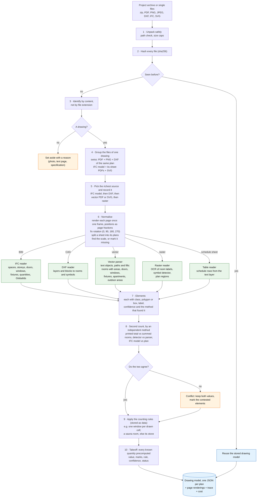

# Pipeline (Stoa challenge)

Status: draft, 2026-11-13 21:50; §3 updated 23:28; stage table and §2 brought up to the code 2026-11-14 00:26. It follows [REQUIREMENTS.md](REQUIREMENTS.md) (ingest once, answer cheaply, two
methods). The per-plan output, the drawing model, becomes decision record 0004.

## 1. Ingestion: from files to one drawing model per plan

All the drawing work happens here, once per file. A question asked later is a lookup in the result, so it costs
almost nothing.

Every stage also appends what it found to the plan's trace (for example "rotated 90°", "9 room labels", "2
conflicts"). The ingest screen shows that trace, and the demo walks through it.

## Stages, what each one writes, and what exists today

Every stage is a module in `backend/app/core/pipeline/` (record [0005](decisions/0005-pipeline-core.md)). Three
adapters are real by default: the vector PDF extractor (`EXTRACTOR_VECTOR=pdf`), the IFC reader (`EXTRACTOR_BIM=ifc`),
the second counter (`SECOND_COUNTER=ifc`, which also runs the PDF one) and the question parser
(`QUESTION_PARSER=templates`); everything else is still a do-nothing
`hello` adapter. "Today" says what each stage does now, as of 2026-11-14 00:26.

Golden v2 (2,948 questions), checked 2026-11-14: end to end (pipeline drawings), with ifc on, 2201 of 2948 (74.7%,
`ANSWER_PRIOR=dev`; 2013, 68.3%, before the IFC route; all 1542 answers that do not abstain are right); on the gold drawings 2876 of 2948 (97.6%). The prior: a question the
drawing gives no value for (a class not read, a schedule not read) gets the dev split's best estimate, marked
`abstain: true`; without it the same run scores 1436 of 2948 (48.7%). Extraction, Part 1 element F1: swiss 100%, ifc_models
80.4%, CubiCasa 0% (the raster route is not read yet; it waits on the literature campaign).

| Stage | Writes | Requirement | Today | Next |
| --- | --- | --- | --- | --- |
| 1-2 Unpack, hash | file inventory with sha256 | I1, I2 | module: size and sha256 per file | store by hash, unpack archives |
| 3-4 Identify, group | drawing groups, set-aside list with reasons | I3 | module: format from the first bytes; group = same folder and name | tell non-drawings apart; IFC model with its sheets |
| 5 Route | the chosen source per drawing | I4 | module: richest format wins (bim, cad, vector, raster) | scanned PDF vs drawn PDF |
| 6 Normalise | page renderings, rotation, plans per sheet, scale and its source | I5, I6, I7 | module: pages as the file gives them. The scale is read by the vector extractor in stage 7, not here | rotation, rendering, plan split |
| 7 Extract: vector | rooms, openings, fixtures, apartments | I8 | `PdfVectorExtractor` (`EXTRACTOR_VECTOR=pdf`, default): reads page 1 of a drawn PDF, and the PNG of the same sheet, in two styles: swiss_dwellings plans (element F1 100%, rooms and areas 100%) and sheets IfcConvert drew from an IFC model (rooms and areas 100%, element F1 80.4%). Reads the scale from text and bar. It says which classes it looked for (`read`), so an unread class gets no count | columns, stairs, railings, slabs and beams on IFC-style sheets; other styles (only their scale is read); pages after the first; SVG |
| 7 Extract: raster | room labels (OCR), symbols (detector), plans | I8 | `hello`, reads nothing: CubiCasa element F1 0%, and its questions are refused or get the dev prior. CubiCasa gold from the SVGs (4,787 files); detector training on dev boxes allowed (0003) | detector and OCR adapter |
| 7 Extract: BIM | IFC elements with GlobalIds, placed on the sheet | I8 | `IfcModelExtractor` (`EXTRACTOR_BIM=ifc`, default): reads the IFC model with ifcopenshell ([0006](decisions/0006-lgpl-dependencies.md)) and lists every object, drawn or not, in `model_objects` (format amendment 0004, PR #55). A space's area is the footprint of its solid. An `.ifc` path gets a page-less drawing. Golden ifc_models Part 1 1630/1630, Part 2 466/466. Dev batch ifc_models: area 1918/1918, length 40/40, volume 86/86, count 415/426 (11 fixture counts have no class). Memory: +1 GB on the dev batch, because ifcopenshell keeps parsed files | IFC gold sheets are still built from SVG shape plus IFC data; no placing of model objects on a sheet |
| 7 Extract: CAD, tables | DXF elements; schedule rows | I8 | none. DXF read for the swiss gold only. Schedules: no reader, so the pipeline has no `tables` and opening_design schedule questions get 0 of 9 area, 3 of 39 count (prior), 0 of 16 text. The answer side is built and gets 8/9, 20/39, 6/16 from gold tables | table reader (schedule rows from the text layer); DXF only if Stoa gives it |
| 8 Second count | the second value and the contested marks | I10 | `SECOND_COUNTER=ifc` (default) compares the sheet's counts against the IFC model's: the 14 golden conflicts are found, with 0 of 102 false alarms. `PdfSecondCounter` (`SECOND_COUNTER=pdf`) brings the scale text and the scale bar, and on swiss plans the printed area of each room. Stage 8 pairs them with the extraction's own values and applies the §2 rules: the bar wins over the text, the printed label wins over the outline area. On golden v2: 0 false alarms on the 102 agree entries. No dev sheet has a real scale or room-area conflict, so those two paths are tested on synthetic sheets only | detector vs parser; printed total vs summed rooms |
| 9 Rules | rule ids per quantity | I9 | one rule, `each-once`. Answering adds a few rules of its own (refuse a class that was not read; a room-area sum is an estimate when one of its rooms is). The dataset's rules are known and validated against the gold (§3) | encode them as `CountingRule`s |
| 10 Takeoff, drawing model | one JSON per plan | I9, I11, I12 | module: a count per class, room type and plan, with marks; areas of rooms and apartments, wall length and volumes where the drawing has them; format fixed in [0004](decisions/0004-extraction-format.md). A class the extractor did not read is refused, not counted as 0 | lengths and volumes from an extractor |

## 2. Conflicts (stage 8)

Stage 8 measures a quantity a second way. If the two values differ by more than the tolerance, the stage keeps both,
marks the contested elements and applies a resolution rule if there is one. The quantity names and methods are the
ones in `app/core/drawing/model.py` (`ConflictQuantity`, `MeasureMethod`). Tolerances are proposed: counts must be
exact (0), areas and scale use Stoa's 2% (the swiss check below used 0.5%).

Built (2026-11-14, 0005): the rows for **scale** and **room area** (printed label vs polygon x scale), on drawn PDF
sheets. When the scale text and the scale bar differ by more than 2%, the bar gives the drawing's scale and the
room areas use it; when a printed room area and the outline area differ, the printed one is put on the room. An
agreement changes nothing. On the 879 dev sheets of the PDF sources, 6,547 room areas and 877 scales were compared
and all agree, so neither path has run on a real sheet. The room count and element count rows against the IFC model
are built too (`SECOND_COUNTER=ifc`) and find the 14 golden conflicts. The other rows are not built: they need a
schedule or a detector.

| Quantity | Method A | Method B | Tolerance | Resolution rule |
| --- | --- | --- | --- | --- |
| room area | `printed_label` | `polygon_x_scale` | 2% | trust the printed label; a bigger gap means the scale or the polygon is wrong |
| floor or apartment area | `printed_total` | `summed_rooms` | 2% | report the printed total; show the room list |
| scale | `scale_text` | `scale_bar` or `dimension_lines` | 2% | measured value over text; text found next to a detail drawing is ignored (see below) |
| room count | `plan_drawing` | `ifc_model` | 0 | keep spaces of the sheet's storey (foreign spaces are greyed) |
| element count | `plan_drawing` | `ifc_model` | 0 | count what the sheet draws |
| element count | `plan_drawing` | `schedule` | 0 | no rule: show both |
| element count | `detector` | `parser` | 0 | no rule yet; the parser wins on vector sheets, the detector is the only source on raster |

How a conflict shows in the answer (answer_v1.1, [0002](decisions/0002-answer-format.md)): `answer` holds the
resolved value, `conflicts` lists every measured value with its method, file, page and box (page and box are null
for a value read from an IFC model), and `resolution` says which rule picked the answer. With no rule, `answer`
holds the best estimate, `confidence` is lowered and `abstain` is true when the system is too unsure. Stoa scores a
null answer as wrong, so `answer` is never empty.

### What the golden set measures

The conflict slice ([GOLDEN.md](GOLDEN.md)) lists, over 62 files, 14 real conflicts and 102 agree entries (checked
2026-11-13 against `data/stoa/extraction_gold/_conflicts/conflicts.jsonl`, review-10).

| | Entries | What |
| --- | --- | --- |
| Conflicts | 14, all `ifc_models`, plan drawing vs IFC model | 8 window counts, 4 room counts, 2 column counts |
| Agree | 102 | ifc_models 68 (door, window, stair, space counts), swiss 30 (printed room area vs polygon x scale), CubiCasa 4 (printed areas vs dimension lines) |

The scorer reports, per quantity, recall of the 14 conflicts and the false-alarm rate on the 102 agree entries. A
predicted conflict on a quantity gold did not check is listed, not judged. It never changes the headline score.

What we learnt while building it:

- **Swiss printed areas agree with the geometry everywhere but rounding.** Of 6,547 printed room areas on the 247
  dev sheets that print them, 6,546 are within 0.5% of the gold room area; the other is 0.86 against 0.855. So the
  swiss slice has no printed-vs-geometry conflict, and the check is cheap enough to run on every sheet.
- **Label-binding traps are a scale-text problem, not a conflict.** On CubiCasa 10022 the text "1:50" heads a
  chimney detail, not the plan, and 13666 has the same trap. The dimension lines give the plan's scale. The numbers
  can't show a disagreement (the PNG has no paper size), so no entry was written. The fix is in stage 6: bind the
  scale text to the plan it heads.
- **IFC windows above the 1.20 m cut are not drawn.** Of the 8 window conflicts, 7 have undrawn windows with sills
  of 1.24 to 1.94 m; the eighth (Tuwien DG1) has 2 roof windows. The IFC total exceeds what the sheet shows, and "count what the sheet draws"
  is our rule. The dataset only asks window counts on 12 sheets where both agree, so it doesn't say what Stoa would
  count on the others.
- **Foreign spaces explain the room-count conflicts.** Sheets that stack storeys tint other storeys' spaces like
  rooms, and lift shafts of another storey look like rooms (9 vs 5, 14 vs 12, 32 vs 26). The fourth room conflict is a roof sheet with no tinted space (0 vs 2); it
  has no resolution, so the answer shows both values. The 2 column conflicts (19 vs 33, twice) are the same
  Vitoria P0 sheet in two project versions.

## 3. Rule packs (stage 9)

A counting rule says which marks count for a quantity. The dataset's questions come from generators with fixed
conventions, and a plain "count what you see" misses them: "how many sinks" counts a double sink once, "area of the
apartment" leaves out outdoor rooms. Each rule is stored as data, one pack per source, so a new source or a
corrected convention is a data change and each rule can be scored on its own.

| Pack | Rules (examples) | Came from | Checked against the dataset |
| --- | --- | --- | --- |
| `cubicasa5k` | windows: every `Window *` group; sinks: all `*Sink*` variants, a double-bowl sink counts 1; showers: `Shower` plus every `Bathtub*`; saunas: a sauna room if there is one, else its stoves; bathrooms: `Space Bath*` unless the label starts with WC | review-1 rule table | 11 of 12 count templates 100%, saunas 2,648 of 2,655 |
| `swiss_dwellings` | room area: polygon minus the polygons nested inside it; apartment: rooms inside its unit outline, outdoor rooms excluded; window: rectangle with 2 or more parallel lines along its long side; double door: opening longer than 45 pt | review-3 (counts), review-4 (areas) | counts 25,562 of 25,568; areas 12,012 of 12,016 |
| `ifc_models` | count only elements the sheet draws (1.20 m cut); rooms: spaces whose IFC storey is the sheet's storey; wall length and volumes from the model's quantities | review-5 and review-6 | 69 sheets: every count and area question reproduced (2 column misses were a gold bug, columns drawn as SVG circles, fixed in PR #42) |
| `opening_design` | schedule counts follow the column the question names: sum `Count` over types whose description starts with the given text; room-door counts read the Room Number column | review-8 | 64 of 64 |

How a rule shows in the answer: every counted quantity in the takeoff carries its rule id and its marks. The answer's
`explanation` names the rule, `evidence` gives one box per counted mark, and `excluded` lists what the rule left out
and why (for example a lift shaft of another storey, or an outdoor room). The ingest trace logs the same. A person
can then check the count against the sheet and disagree with the rule instead of the number.

The rule values (fills 228 and 243, stroke colours, the 45 pt door length) were found on this dataset and may not
hold on other drawings. The rules were fitted on the same questions they are checked on, except the swiss window
rule, which has a fit half and a test half (98.8% on the test half).

### Building-code rule packs (design only, cut from the build on 2026-11-13)

Roadmap decision 7 (Bogdan, 2026-11-13, "yes"): building-code checks are not built. This is what a pack
would hold, so the idea isn't lost:

- One pack per code (for example a Finnish building code): rules such as minimum room area, minimum window area
  against floor area, door width, stair width, escape distance. Each rule is a quantity from the takeoff, a
  comparison and a limit, with a clause reference.
- A check reads the takeoff and writes pass, fail or "cannot tell" per rule, with the marks of the elements involved.
  "Cannot tell" covers a missing scale or a quantity the drawing doesn't show.
- It shows in the answer the same way a counting rule does: rule id, marks, `explanation`.

Why it isn't built: the dataset has no questions on building codes, so there is nothing to score a pack against and
a check could not be shown to be right. The time goes to the counting rules, which the questions do test.
