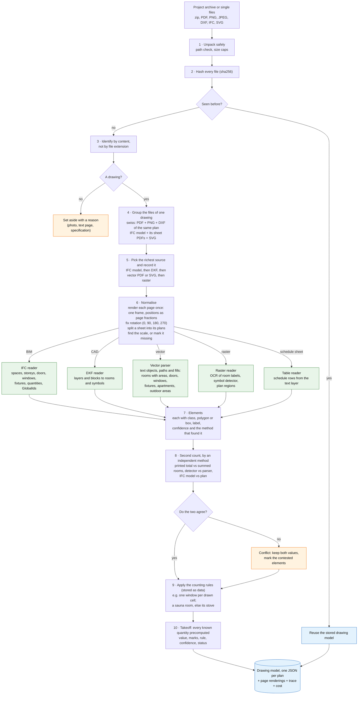

# Pipeline (Stoa challenge)

Status: draft, 2026-11-13 21:50. It follows [REQUIREMENTS.md](REQUIREMENTS.md) (ingest once, answer cheaply, two
methods). The per-plan output, the drawing model, becomes decision record 0004.

## 1. Ingestion: from files to one drawing model per plan

All the drawing work happens here, once per file. A question asked later is a lookup in the result, so it costs
almost nothing.

Every stage also appends what it found to the plan's trace (for example "rotated 90°", "9 room labels", "2
conflicts"). The ingest screen shows that trace, and the demo walks through it.

## Stages, what each one writes, and what exists today

| Stage | Writes | Requirement | Today |
| --- | --- | --- | --- |
| 1-2 Unpack, hash | file inventory with sha256 | I1, I2 | to build |
| 3-4 Identify, group | drawing groups, set-aside list with reasons | I3 | to build |
| 5 Route | the chosen source per drawing | I4 | to build |
| 6 Normalise | page renderings, rotation, plans per sheet, scale and its source | I5, I6, I7 | scale from the sheet text is in the prototypes; rotation and plan split to build |
| 7 Extract: vector | rooms, openings, fixtures, apartments | I8 | prototype, `prototypes/pdf-extract/` (swiss counts 99.9%, areas 99.97%, IFC plan areas 97%; not blind) |
| 7 Extract: raster | room labels (OCR), symbols (detector), plans | I8 | research; detector training on dev-split boxes allowed (decision 0003) |
| 7 Extract: BIM | IFC elements with GlobalIds, placed on the sheet | I8 | to build; waits on the ifcopenshell licence decision |
| 7 Extract: CAD, tables | DXF elements; schedule rows | I8 | DXF only if Stoa gives it; tables surveyed, not built |
| 8 Second count | the second value and the contested marks | I10 | to build |
| 9 Rules | rule ids per quantity | I9 | known for CubiCasa (board #15) and swiss (in the prototypes); to encode as data |
| 10 Takeoff, drawing model | one JSON per plan | I9, I11, I12 | schema proposed; decision record 0004 to write |
