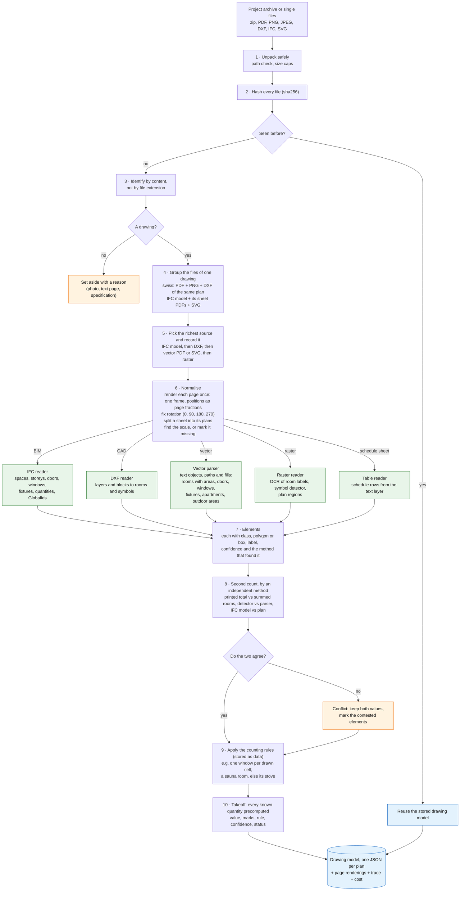

# Pipeline (Stoa challenge)

Status: draft, 2026-11-13 21:50; §3 updated 23:28; stage table and §2 brought up to the code 2026-11-14 00:26; rows 3-4, 5, 7 (vector, raster) and 10 checked again 2026-11-14 21:30 against the merges of that evening; the golden paragraph, rows 1-2 and 5 and §4-§6 (demo config, parallel ingest, memory, drawable sheets, services) checked 2026-11-15 01:30 against main 3d0dc59, row 1-2 and §4 again at 02:15 against b8c9d8e4 (#414, #425, #434, #443), §4-§6 at 02:50 against 992d98b1 (#422, #464), §4 at 02:45 against 98588dcc (#480, #486), rows 7 and §6 at 02:50 against f54bbce2 (#455, #475), §4 and §6 at
03:10 against 1c20bc31 (#439, #490, #495, #503, #506, #511, #512, #515), §4 and §6 at 03:15 against d004a67e
(#491, #498, #499, #517), rows 3-4 and 7, §4 at 04:10 against 1b2f5ba1 (#527, #555, #557, #562), §4 and §6 at 04:35
against f5a58f54 (#538, #551, #554, #558, #575, #580), rows 3-4 and 7, §2, §4 and §6 at 06:00 against ca404d42 (#588,
#590, #596, #597, #598, #600, #603, #612, #614, #618, #619, #622, #652). It follows [REQUIREMENTS.md](REQUIREMENTS.md) (ingest once, answer cheaply, two
methods). The per-plan output, the drawing model, becomes decision record 0004.

## 1. Ingestion: from files to one drawing model per plan

All the drawing work happens here, once per file. A question asked later is a lookup in the result, so it costs
almost nothing.

Every stage also appends what it found to the plan's trace (for example "rotated 90°", "9 room labels", "2
conflicts"). The ingest screen shows that trace, and the demo walks through it.

## Stages, what each one writes, and what exists today

Every stage is a module in `backend/app/core/pipeline/` (record [0005](decisions/0005-pipeline-core.md)). Five
adapters are real by default: the vector PDF extractor (`EXTRACTOR_VECTOR=pdf`), the IFC reader (`EXTRACTOR_BIM=ifc`),
the second counter (`SECOND_COUNTER=ifc`, which also runs the PDF one), the schedule reader (`TABLES=pdf`) and the question parser
(`QUESTION_PARSER=templates`); everything else is still a do-nothing
`hello` adapter (the raster extractor, `EXTRACTOR_RASTER`, is `hello` unless the config says `composite`). The
demo config turns most of the rest on; §4 lists what it turns on and what stays off, and why. "Today" says what
each stage does now.

Golden v2 (2,948 questions), end to end in the demo config of main 030abbb (2026-11-15 00:41, no key, cached
replies): 2749 of 2948 (93.2%; dev 92.8%, holdout 95.0%, 3.8% abstained). Part 1 element F1: CubiCasa 86.3%,
ifc_models 100%, swiss 100%; CubiCasa rooms whose area is within 2%: 57 of 82. The prior (`ANSWER_PRIOR=dev`): a
question the drawing gives no value for (a class not read, a schedule not read) gets the dev split's best estimate,
marked `abstain: true`. The whole series, from 0% on 2026-11-13 23:24, is in [GOLDEN.md](GOLDEN.md) "The pipeline
series".

| Stage | Writes | Requirement | Today | Next |
| --- | --- | --- | --- | --- |
| 1-2 Unpack, hash | file inventory with sha256 | I1, I2 | `ZipUnpacker` (`adapters/archive/unpack.py`) unpacks a zip safely: at most 5,000 entries, 600 MB per file, 2 GB in all, 200x expansion per entry over 1 MB (a zip bomb), one nested zip level; what it skips is listed with the reason. A zip name without the UTF-8 flag is read as UTF-8 when it decodes as such (#434). Each TIFF page (up to 50) and each WebP becomes an 8-bit PNG sheet (`x.png`, `x#p2.png`; 1-bit stays grey, 16-bit is scaled, 150 Mpx cap; #425), and an image with transparency is shown and checked on white (#434). A second file at a path already taken is set aside at a free name (#443). Size and sha256 per file. What a group ended as is stored by content (the files' and the group's sha256 plus the readers), so the same group uploaded again is reused unless the run is fresh | |
| 3-4 Identify, group | drawing groups, set-aside list with reasons | I3 | module: format from the first bytes; group = same folder and name. The sheet-kind step (`SHEET_KIND=carbon`, off by default) also puts a sheet's discipline (architecture, structural, plumbing, heating, ventilation, electrical, fire, site, other) on the file, from the sheet kind, title and number (#311); the services picture lane reads it (`DISCIPLINE_PICTURES`, on in the demo). With `SHEET_DISCIPLINE=gemini` (default `rules`, on in the demo since #598; #562) the sheet-kind reply names the discipline from what is drawn, for a services sheet whose title names no service. A sheet the step calls a services plan (`mep_plan`) with confidence over 0.9 gets no door, window or fixture counts: they are refused with the flag's words, and room counts are still answered, flagged; "Read it as a floor plan" clears it (#596) | tell non-drawings apart; IFC model with its sheets |
| 5 Route | the chosen source per drawing | I4 | module: richest format wins (bim, cad, vector, raster). A scanned PDF goes to the raster route: `ScanImages` renders its page 1 once, at 150 px per inch (fewer when the page would pass the pixel cap), and every raster reader shares that render (#280). The renders are kept by content hash, the last 8 files; a render holds up only readers of its own page, and answers share it (#295). The render states its resolution, so a printed ratio on a scan can become the sheet's scale, if its resolution passes the trust check (§2; #300, #340), when `RASTER_PRINTED_SCALE=carbon` is on (default `off`; on in the demo config). A printed scale more than 2x from the door estimate is left to a person: a bar still wins, a ratio does not (§2). `VECTOR_FALLBACK=raster` (default `off`) sends a drawn PDF that matches no sheet style the same way, flagged, never certified (#283). Stages 4-10 run per drawing group, several groups at once when `INGEST_GROUPS_IN_FLIGHT` is above 1 (§5) | scanned PDF vs drawn PDF by the page itself, not the file |
| 6 Normalise | page renderings, rotation, plans per sheet, scale and its source | I5, I6, I7 | module: pages as the file gives them. The scale is read by the vector extractor in stage 7, not here | rotation, rendering, plan split |
| 7 Extract: vector | rooms, openings, fixtures, apartments | I8 | `PdfVectorExtractor` (`EXTRACTOR_VECTOR=pdf`, default): reads page 1 of a drawn PDF, and the PNG of the same sheet, in two styles: swiss_dwellings plans (element F1 100%, rooms and areas 100%) and sheets IfcConvert drew from an IFC model (rooms and areas 100%, element F1 80.4%). Reads the scale from text and bar. Printed scales: metric `1:N` is read per line of page text and imperial (`1/4" = 1'-0"`, also with a fraction glyph, primes or `IN.`/`FT.`; #612) per text object. A ratio next to a slope word ("1:12 RAMP SLOPE", "1:10 MAX") is not a scale. A sheet that prints several different scales and has no scale bar gets none, with a note; a bar still gives the scale (#282). A bar counts only when its labels carry one unit, metres or feet; a view callout with a number is not a bar (#301). It says which classes it looked for (`read`), so an unread class gets no count. On an IFC-style sheet every cut solid (walls, columns, other building parts) is listed as a wall, and a door is put together from its frame and swing shapes, so a door drawn edge-on is missed: the wall and door counts of such a sheet are estimates with the reason, Low, with a check asked (#455; Molio plan 08 alone: 64 walls against the model's 26, 17 doors against 18). Its windows stay as they were | columns, stairs, railings, slabs and beams on IFC-style sheets; other styles (only their scale is read); pages after the first; SVG |
| 7 Extract: raster | room labels (OCR), symbols (detector), plans | I8 | `hello` (default), reads nothing: CubiCasa element F1 0%, and its questions are refused or get the dev prior. `EXTRACTOR_RASTER=composite` reads a sheet with the components `RASTER_COMPONENTS` names (detector, room readers, `carbon`). `CARBON_READER=large` (default `off`; on in the demo config): on an image over 4,000 px, or a smaller page where the shipped reader found fewer than 3 things (#293), Carbon counts the things drawn (its doors, windows and fixtures replace the shipped reader's) and the shipped reader keeps the rooms. On a big sheet the two reads run at the same time (#306); the few-things case runs after the shipped read. Carbon's door boxes snap to the detector's door opening where one lies inside (#310). `RASTER_PRINTED_SCALE=carbon` (default `off`; on in the demo config) reads the printed scale beside the reader (§2). A room box that holds 2 or more of the page's other room boxes (each at least 90% inside it) gets no area, so a wing boxed over its rooms is not counted twice; the sheet's area total leaves it out and is marked partial (#622). A room count read off a picture is partial too: it goes out Low and says it counts only the rooms found, naming room numbers it skipped (#600). CubiCasa gold from the SVGs (4,787 files); detector training on dev boxes allowed (0003) | detector and OCR adapter |
| 7 Extract: BIM | IFC elements with GlobalIds, placed on the sheet | I8 | `IfcModelExtractor` (`EXTRACTOR_BIM=ifc`, default): reads the IFC model with ifcopenshell ([0006](decisions/0006-lgpl-dependencies.md)) and lists every object, drawn or not, in `model_objects` (format amendment 0004, PR #55). A space's area is the footprint of its solid. An `.ifc` path gets a page-less drawing, also a services model that lists none of the plan's classes (`model_objects: []`, 0004's amendment of 2026-11-15; #475). A model file asked on its own counts its spaces by room type (bedrooms, kitchens and so on), read from their names with the word table drawn IFC sheets use (#527, #555). Golden ifc_models Part 1 1630/1630, Part 2 466/466. Dev batch ifc_models: area 1918/1918, length 40/40, volume 86/86, count 415/426 (11 fixture counts have no class). Memory: +1 GB on the dev batch, because ifcopenshell keeps parsed files | IFC gold sheets are still built from SVG shape plus IFC data; no placing of model objects on a sheet |
| 7 Extract: CAD, tables | DXF elements; schedule rows | I8 | DXF read for the swiss gold only. `TABLES=pdf` (default) reads the ruled schedules printed on a drawn PDF sheet, on the vector route; its scores are in GOLDEN.md "Schedules". The 0/9, 3/39 and 0/16 this row once gave for opening_design schedule questions are from before that reader | schedules on scans and photos; DXF only if Stoa gives it |
| 8 Second count | the second value and the contested marks | I10 | `SECOND_COUNTER=ifc` (default) compares the sheet's counts against the IFC model's: the 14 golden conflicts are found, with 0 of 102 false alarms. `PdfSecondCounter` (`SECOND_COUNTER=pdf`) brings the scale text and the scale bar, and on swiss plans the printed area of each room. Stage 8 pairs them with the extraction's own values and applies the §2 rules: the bar wins over the text, the printed label wins over the outline area. On golden v2: 0 false alarms on the 102 agree entries. No dev sheet has a real scale or room-area conflict, so those two paths are tested on synthetic sheets only | detector vs parser; printed total vs summed rooms |
| 9 Rules | rule ids per quantity | I9 | one rule, `each-once`. Answering adds a few rules of its own (refuse a class that was not read; a room-area sum is an estimate when one of its rooms is). The dataset's rules are known and validated against the gold (§3) | encode them as `CountingRule`s |
| 10 Takeoff, drawing model | one JSON per plan | I9, I11, I12 | module: a count per class, room type and plan, with marks, its keys in one fixed order whatever the hash seed (#318); areas of rooms and apartments, wall length and volumes where the drawing has them; format fixed in [0004](decisions/0004-extraction-format.md). A class the extractor did not read is refused, not counted as 0 | lengths and volumes from an extractor |

## 2. Conflicts (stage 8)

Stage 8 measures a quantity a second way. If the two values differ by more than the tolerance, the stage keeps both,
marks the contested elements and applies a resolution rule if there is one. The quantity names and methods are the
ones in `app/core/drawing/model.py` (`ConflictQuantity`, `MeasureMethod`). Tolerances are proposed: counts must be
exact (0), areas and scale use Stoa's 2% (the swiss check below used 0.5%).

Built (2026-11-14, 0005): the rows for **scale** and **room area** (printed label vs polygon x scale), on drawn PDF
sheets. When the scale text and the scale bar differ by more than 2%, the bar gives the drawing's scale and the
room areas use it; when a printed room area and the outline area differ, the printed one is put on the room. An
agreement changes nothing. On the 879 dev sheets of the PDF sources, 6,547 room areas and 877 scales were compared
and all agree, so neither path has run on a real sheet. The room count and element count rows against the IFC model
are built too (`SECOND_COUNTER=ifc`) and find the 14 golden conflicts. The other rows are not built: they need a
schedule or a detector.

| Quantity | Method A | Method B | Tolerance | Resolution rule |
| --- | --- | --- | --- | --- |
| room area | `printed_label` | `polygon_x_scale` | 2% | trust the printed label; a bigger gap means the scale or the polygon is wrong |
| floor or apartment area | `printed_total` | `summed_rooms` | 2% | report the printed total; show the room list |
| scale | `scale_text` | `scale_bar` or `dimension_lines` | 2% | measured value over text; text found next to a detail drawing is ignored (see below) |
| scale (raster) | `detector` (door estimate) | `scale_bar` or `scale_text` | 10% | the printed scale; the estimate stays as the other value (`RASTER_PRINTED_SCALE`); over 2x apart only a bar wins, and flags the areas |
| element or room count (raster) | the reader's (`detector`...) | `printed_total` | 0 | no rule: show both; a printed "48 DORMS" never replaces the count (`RASTER_PRINTED_SCALE`) |
| room count | `plan_drawing` | `ifc_model` | 0 | keep spaces of the sheet's storey (foreign spaces are greyed) |
| element count | `plan_drawing` | `ifc_model` | 0 | count what the sheet draws of its storey; an element of another storey seen through the cut is left out, listed with why (the sheet's count is its storey's, so the plain question carries the conflict too) |
| element count | `plan_drawing` | `schedule` | 0 | no rule: show both |
| element count | `detector` | `parser` | 0 | no rule yet; the parser wins on vector sheets, the detector is the only source on raster |

Raster printed scale and facts (2026-11-14, r8 AY, `RASTER_PRINTED_SCALE=off|carbon`, default off;
`app/core/pipeline/printed.py`): the scale is metres per page unit. A scale bar gives it (its labelled length over
its drawn length on the page). A printed ratio gives it from the paper size, but only when the file's stated
resolution passes the trust check (PNG pHYs or JPEG density, 100-1200 dpi, the same both ways, not 72 or 96, and
not on a camera photo, whose EXIF resolution says nothing about the paper; #597). On an
image the paper size is that resolution. On a scanned PDF the page is in points, 72 to the inch, and the render's
resolution only lets the ratio through (#340): the render is 150 px per inch, scaled down to the 16 MP cap, so a
page over about 1,600 sq in (ARCH E, 36 x 48 in, and up) renders below 100 px per inch and gets no printed ratio.
The printed scale replaces the door estimate and the room areas are measured again at it. When the two are more than
2x apart (`ESTIMATE_RANGE`), one is a misread: a measured bar still wins, and every area and length on the sheet
becomes an estimate naming both scales (never certified, Low); a ratio does not win (the estimate stays, no rule
decides). A printed count of an element class, a room type or all rooms is a second value of that count; a
Finnish flat type read as a room count (4H+K, 3h+k+s: the flat's type, not the rooms drawn) is not one, and stays in
the notes (2026-11-14). A sheet's total room count read more than 2x the other count (all above 0, no rule) means the other counts
something else: the reading is kept, both values stay on the entry, no person is asked. Within 2x, with a 0, with
more printed than read (the reader may have missed rooms), for one room type's count (120 bedrooms vs 48 DORMS) or for
an element count, a person decides. `carbon`
reads them with the Carbon client (page call shared with `CARBON_READER`, a bars call, one full-resolution call per
bar), on the process's spend guard.

How a conflict shows in the answer (answer_v1.1, [0002](decisions/0002-answer-format.md)): `answer` holds the
resolved value, `conflicts` lists every measured value with its method, file, page and box (page and box are null
for a value read from an IFC model), and `resolution` says which rule picked the answer. With no rule, `answer`
holds the best estimate, `confidence` is lowered and `abstain` is true when the system is too unsure. Stoa scores a
null answer as wrong, so `answer` is never empty.

### What the golden set measures

The conflict slice ([GOLDEN.md](GOLDEN.md)) lists, over 62 files, 14 real conflicts and 102 agree entries (checked
2026-11-13 against `data/stoa/extraction_gold/_conflicts/conflicts.jsonl`, review-10).

| | Entries | What |
| --- | --- | --- |
| Conflicts | 14, all `ifc_models`, plan drawing vs IFC model | 8 window counts, 4 room counts, 2 column counts |
| Agree | 102 | ifc_models 68 (door, window, stair, space counts), swiss 30 (printed room area vs polygon x scale), CubiCasa 4 (printed areas vs dimension lines) |

The scorer reports, per quantity, recall of the 14 conflicts and the false-alarm rate on the 102 agree entries. A
predicted conflict on a quantity gold did not check is listed, not judged. It never changes the headline score.

What we learnt while building it:

- **Swiss printed areas agree with the geometry everywhere but rounding.** Of 6,547 printed room areas on the 247
  dev sheets that print them, 6,546 are within 0.5% of the gold room area; the other is 0.86 against 0.855. So the
  swiss slice has no printed-vs-geometry conflict, and the check is cheap enough to run on every sheet.
- **Label-binding traps are a scale-text problem, not a conflict.** On CubiCasa 10022 the text "1:50" heads a
  chimney detail, not the plan, and 13666 has the same trap. The dimension lines give the plan's scale. The numbers
  can't show a disagreement (the PNG has no paper size), so no entry was written. The fix is in stage 6: bind the
  scale text to the plan it heads.
- **IFC windows above the 1.20 m cut are not drawn.** Of the 8 window conflicts, 7 have undrawn windows with sills
  of 1.24 to 1.94 m; the eighth (Tuwien DG1) has 2 roof windows. The IFC total exceeds what the sheet shows, and "count what the sheet draws"
  is our rule. The dataset only asks window counts on 12 sheets where both agree, so it doesn't say what Stoa would
  count on the others.
- **Foreign spaces explain the room-count conflicts.** Sheets that stack storeys tint other storeys' spaces like
  rooms, and lift shafts of another storey look like rooms (9 vs 5, 14 vs 12, 32 vs 26). The fourth room conflict is a roof sheet with no tinted space (0 vs 2); it
  has no resolution, so the answer shows both values. The 2 column conflicts (19 vs 33, twice) are the same
  Vitoria P0 sheet in two project versions.

## 3. Rule packs (stage 9)

A counting rule says which marks count for a quantity. The dataset's questions come from generators with fixed
conventions, and a plain "count what you see" misses them: "how many sinks" counts a double sink once, "area of the
apartment" leaves out outdoor rooms. Each rule is stored as data, one pack per source, so a new source or a
corrected convention is a data change and each rule can be scored on its own.

| Pack | Rules (examples) | Came from | Checked against the dataset |
| --- | --- | --- | --- |
| `cubicasa5k` | windows: every `Window *` group; sinks: all `*Sink*` variants, a double-bowl sink counts 1; showers: `Shower` plus every `Bathtub*`; saunas: a sauna room if there is one, else its stoves; bathrooms: `Space Bath*` unless the label starts with WC | review-1 rule table | 11 of 12 count templates 100%, saunas 2,648 of 2,655 |
| `swiss_dwellings` | room area: polygon minus the polygons nested inside it; apartment: rooms inside its unit outline, outdoor rooms excluded; window: rectangle with 2 or more parallel lines along its long side; double door: opening longer than 45 pt | review-3 (counts), review-4 (areas) | counts 25,562 of 25,568; areas 12,012 of 12,016 |
| `ifc_models` | count only elements the sheet draws (1.20 m cut); rooms: spaces whose IFC storey is the sheet's storey; wall length and volumes from the model's quantities | review-5 and review-6 | 69 sheets: every count and area question reproduced (2 column misses were a gold bug, columns drawn as SVG circles, fixed in PR #42) |
| `opening_design` | schedule counts follow the column the question names: sum `Count` over types whose description starts with the given text; room-door counts read the Room Number column | review-8 | 64 of 64 |

How a rule shows in the answer: every counted quantity in the takeoff carries its rule id and its marks. The answer's
`explanation` names the rule, `evidence` gives one box per counted mark, and `excluded` lists what the rule left out
and why (for example a lift shaft of another storey, or an outdoor room). The ingest trace logs the same. A person
can then check the count against the sheet and disagree with the rule instead of the number.

The rule values (fills 228 and 243, stroke colours, the 45 pt door length) were found on this dataset and may not
hold on other drawings. The rules were fitted on the same questions they are checked on, except the swiss window
rule, which has a fit half and a test half (98.8% on the test half).

### Building-code rule packs (built 2026-11-14, story #139)

A pre-check of a few rules, not a compliance certificate. Bogdan reversed the 2026-11-13 cut on 2026-11-14 at
12:20 ("MUST DO"); the contract is decision [0009](decisions/0009-building-code-checks.md), the API
`GET /api/drawings/{id}/checks?pack=` (docs/API.md "Building-code checks").

- A pack is data, one per law: `backend/app/rules/<id>.json` (`fi`: Finland, decrees 631/2024 and 241/2017;
  `ch-zh`: the Canton of Zürich's PBG). `app/adapters/rule_packs.py` loads them at start and refuses a pack with a
  rule that quotes no clause (ref, https URL, sentence), an unknown op or room type, or a repeated id.
- Each rule is an op over the drawing model (`app/core/checks/check.py`, pure): `room_area` (each room of the
  types, its area), `room_windows` (the windows within 0.35 m of the room's outline, or a building model's count
  for the space), `door_width` (each door that meets a room of the types and none of the excluded ones, the long
  side of its symbol at the scale, or the model's width) and `takeoff` (one takeoff quantity).
- Each result is pass, fail or cannot tell, with one plain sentence, the marks of the room or door and of what was
  counted, and the takeoff row and mark id they are in. Cannot tell covers a missing scale, a class that was not
  read, an item with no position, an estimate whose error reaches the limit, and every input not reliable enough
  to fail on: a room's area from an outline read off a picture, a room with no window found on a picture, a door
  box on a picture, a door measured at a scale estimated from the doors, a room lit through a door to a balcony
  or the outside, and windows on a sheet drawn from a building model when the model gives no count.
- A door's symbol bounds its clear opening from above: under the limit (less 0.03 m for the drawing) is a fail;
  at least 0.10 m (our frame allowance, not the law's) plus 0.03 m over it is a pass; between is cannot tell.

Measured on the pipeline's dev drawings (run `pipeline-bd2471f-20261114-101635`, 171 drawings, `fi` pack,
2026-11-14): 6 fails, all on drawn Swiss sheets (kitchen doors of 0.70-0.76 m), and all 6 fail on the gold
drawing too; 0 fails on the 91 raster and 44 IFC drawings, where the inputs are held as cannot tell. The fails
before those holds, and why each was or was not real, are in decision 0009.

## 4. Settings: the demo config and what stays off

Every reader beyond the five defaults above is off until a setting turns it on; `backend/.env.example` has one
commented line per setting. The live demo runs with the settings `tools/qa-env.sh config` prints (checked
2026-11-15 on main ca404d42):

| In the demo | Default | What it turns on |
| --- | --- | --- |
| `EXTRACTOR_RASTER=composite` with `RASTER_COMPONENTS` | `hello` | The image route: the C-yolo26l detector in eight views, the local count arbiter T1 for doors, windows, sinks, toilets, showers and bathtubs, and Gemini rooms through the region filter |
| `RECTIFIER=r3` | `none` | A camera photo of a plan is flattened before it is read |
| `RASTER_SCALE=priors` | `off` | A scan that prints no scale gets one estimated from its doors; its areas are labelled estimates with a band |
| `RASTER_PRINTED_SCALE=carbon` | `off` | A measured printed scale (a bar, or a ratio at a resolution the file states) replaces the estimate (§2) |
| `CARBON_READER=large` | `off` | Carbon counts what is drawn on an image over 4,000 px, or on a page where the shipped reader found fewer than 3 things; flagged, never certified |
| `CARBON_LEVELS=ladder` | `off` | Carbon reads every raster drawing: a Medium answer it disagrees with drops to Low, one it agrees with rises to High |
| `DECISIONS_CONFIDENCE`, `DECISIONS_KIND`, `GATE_POLICY`, `ANSWER_POLICY`, `CHECK_POLICY`, `DOUBLE_CHECK_READERS`, `LOCAL_GATES` | off or empty | The confidence levels and the double-check, from policy files frozen in `eval/results/` (fitted on val, certified once on test) |
| `ANSWER_PRIOR=dev` | `none` | A question the drawing gives no value for gets the dev split's best estimate, marked `abstain: true` |
| `SHEET_KIND=carbon`, `SHEET_KIND_SET_ASIDE=false` | `off`, `true` | Carbon says what each sheet looks like; a sheet that may not be a floor plan is read and flagged, never set aside |
| `CHAT_MODEL=gemini` | `rules` | The chat agent runs on a Gemini model; with `rules`, keyword rules choose the tools |
| `IFC_FACTS=true` | `false` | An IFC model's fact sheet answers what the takeoff does not, in the batch answers and in the chat (§6) |
| `IFC_FACTS_CACHE=../data/cache/facts` | `""` (in memory) | Fact sheets are read from the folder the deploy's precompute writes, so no IFC question starts a build (#512) |
| `MODEL_3D=true` | `false` | The 3D view of an IFC file (`GET .../files/{file_id}/model.glb`), converted alone in a child process held to 1,500 MB and 120 CPU seconds; `app.cli glb` converts ahead |
| `TRIAGE_DESCRIBER=carbon`, `TRIAGE_JUDGE=rules`, `EVIDENCE_SCOPE=all_non_plan` | `off`, `off`, `set_aside` | A set-aside image is described by Carbon for the evidence index (about 0.005 USD an image), rules judge whether a set-aside file belongs to the project, and the index holds every non-plan file and PDF page (decision 0012) |
| `SERVICES_FOLLOW=on` | `off` | A project's plumbing, ventilation and heating models are followed through every plan edit, and the chat gets the services tools (§6) |
| `SHEET_DISCIPLINE=gemini` | `rules` | The sheet-kind reply also names each sheet's discipline from what is drawn: 65 of 70 services and structural sheets right, against 36 of 70 for the rules, and no triage change on the demo files (#562, #598). Turning it on pays one more sheet-kind reply per sheet already cached |
| `DISCIPLINE_PICTURES=gemini` | `off` | A sheet that triage names a services or structural sheet (a scan, a photo, or a drawn PDF's render beside its paths) is read for its legend, symbols and coloured runs into a fact sheet; its answers are Low and ask for a double-check, and it can follow a plan edit (§6). One Carbon call a page, about 0.03 USD, cached by content. On a held-out rendered building (DigitalHub, 36 pages): P 0.95, R 0.92, counts within 10% 46 of 54 (#579; the other readers below) |
| `INGEST_GROUPS_IN_FLIGHT=10`, `INGEST_LOCAL_IN_FLIGHT=1` | `1`, `1` | Up to 10 drawing groups are read at once, with one local image reading at a time (§5) |
| `CARBON_CALLS_IN_FLIGHT=48`, `CARBON_READ_WORKERS=12` | `8`, `4` | Up to 48 Carbon calls in flight in the process, 12 of them for one sheet's tiles; calls already in flight can go past `GEMINI_BUDGET_USD` |
| `USER_SCALE=true` | `false` | In the agent chat, a user can give the scale of a drawing that has none ("the scale is 1:100", "the kitchen is 12 m2", "Room 301 is 18 m2"). That chat's areas and lengths on the drawing are then measured with it and answered Low, "using the scale you gave", never sure. A ratio is refused on an image that states no resolution (#432, #480, #496; on since #512) |
| `MALLOC_ARENA_MAX=2` | glibc's | Fewer malloc arenas: peak 9.6 to 6.7 GB on the same cached replay, no slower (33.1 vs 36.5 s) |

Off in the demo on purpose, with what was measured:

| Setting | Why it stays off |
| --- | --- |
| `SCALE_CARBON_DOORS` | Meant for a scan whose detector found no door: the area scale would come from Carbon's door boxes (door width `CARBON_DOOR_M` 1.069 m, fitted on one half of a set of rendered scans with a known scale; 11 of 11 sheets of the other half inside the band; #401). On a fresh set of 68 questions about public scans nobody on the team had used (truths by eye, hashed before any run), main 030abbb with it off gave 36 right, 12 wrong, 20 refused; with it on 37, 14, 17. All three changes were on one sheet with a hand-written 1/4" scale the reader did not read: the kitchen came out 16 m² against 9.8 and the house 149 m² against 100, both outside the ±16% band the answer printed (the third change was a right answer). A wrong number whose stated band does not hold is worse than a refusal, so it stays off. #417 now gives no door scale when a printed scale was seen but not read; that has not been measured with the setting on. On golden v2 the setting changes nothing (Carbon reads elements only on images over 4,000 px) |
| `DISCIPLINE_PICTURES=template` or `glyphs` (#414, #579; the demo uses `gemini`, above) | With `template`, a scan that triage names a services or structural sheet is read by local readers only (legend, symbols, coloured runs) into a fact sheet whose answers are Low, decision 0015. Tudor's per-class bench on pictures rendered from the services models (#281): counts within ±10% 49% of the time on clean renders, 37% on scans, 35% at 100 dpi and 36% on photos; on scans precision falls to 0.05-0.2; 8% of run lengths within 10%. Run end to end on #414 with the readers on (10 bench pictures), nothing reached a user. #486 made the readers work end to end and cleans each page before reading it (a median filter on salt-and-pepper pages, flattening, deskew up to ±2°). On the tune half of noisy 150 dpi pictures, with the legend boxes given, precision went from 0.58, 0.56 and 0.17 to 0.97, 0.92 and 1.00 (air terminals, other symbols, lights), at recall 0.87, 0.73 and 0.93. #486 reports only the tune half, and in real use nobody gives the legend boxes, so it stays off until a bench passes. Pairing a picture with the plan's floor and laying it over are in §6, with what they measured; the DINO symbol check, not called yet, now confirms only air terminals (#551). `gemini` (one Carbon call per page reads the legend and the symbols, $0.030 a page, replies cached) and `glyphs` (a trained glyph detector on the CPU) were measured (#579) on a held-out rendered building (DigitalHub, 36 pages, trained on the clinic only): gemini P 0.95 R 0.92, counts within 10% 46 of 54; glyphs P 0.92 R 0.38 with the OCR legend, 0.96/0.82 with the true legend boxes; template P 0.07 R 0.29. So the demo uses `gemini`; `template` only double-checks its counts there (§6) |
| `DISCIPLINE_RUNS=graph` (default `mask`; #603) | The pictures' run lengths from a line graph per legend line style (thinned, gaps up to 1.0 m bridged, a run per connected network) instead of one piece per coloured strip. On held-out DigitalHub renders with the true legend boxes and scale it was within 10% on 33 of 64 clean and photo runs, against 22 of 64 for `mask`, a narrow pass of its pre-registered line (32 needed); grey scans 0 of 32 for both. The default was left at `mask` (#652). Its elbow and tee joins stay off: at 1.0 m they reached pair precision 0.73 and recall 0.19, under the pre-registered 0.9 and 0.5 |
| `RASTER_TILES` | Large sheets took 77 to 95 s longer each in the all-on run, and its CubiCasa criterion failed (#381) |
| `VECTOR_FALLBACK` | Failed its pre-registered check (#381) |
| `RESOLVER=carbon` | The pilot was inconclusive, and its cost is paid inline on every answer (#381) |
| `TRIAGE_CLASSIFIER` | No arm passed the gate (#381). With `rules`, an image the content probe calls a photo is set aside before the sheet-kind check, so the sample's `photos/site.jpg` goes from read and flagged to set aside (#512) |

## 5. Ingest at scale: parallel groups and memory

Ingest reads a project's drawing groups on a pool of `INGEST_GROUPS_IN_FLIGHT` threads (`core/ingest/groups.py`,
#395); the demo reads up to 10 at once (#422), the default, 1, one after another. Groups that share a file, a source (a building's
sheets and its IFC model) or a file's content form one lane and are read in upload order, so no source is read by
two groups at once and a copy still reuses the first reading. A group that fails does not stop the others; the
project still fails with the first error. Each group keeps its own stage clock and counts its own cost, so every
stage's time and cost stay with its file, and the status is saved only on the run's thread.

Two limits hold beside it, both settings: at most `CARBON_CALLS_IN_FLIGHT` Carbon calls are in flight per process
(every `CarbonClient` call, around the HTTP call only; 8 by default, 48 in the demo), and the image route's local
reading runs `INGEST_LOCAL_IN_FLIGHT` sheets at a time per process (`adapters/one_at_a_time.py`; 1), while the
Carbon reads beside it stay outside that slot. Without the slot, 4 groups at once swapped 16 GB. Files are probed
as many at once as groups are read (at least 4). Measured cold, with real Gemini and one run each: 6 images took
253.0 s one group at a time and 78.9 s at 4 groups (#395); 10 files (6 hard images, 2 drawn PDFs, 2 scans) took
273.1 s on main and 88.3 s with #422's settings, 2.78 USD, cgroup peak 7.3 GB (#422; that run had 24 workers per
sheet, the merged demo config 12). Replayed from cached replies, the
stored drawings are byte-identical, and golden v2 changes no answer (0 of 3058) and no extraction file (204 of 204).

Memory. A big greyscale page is held once, in its own mode (#405, #410): no reader makes a full-page RGB copy.
The pixel digest hashes 256-row strips, Carbon's and the printed-scale reader's JPEG is resized before it becomes
RGB, and the detector keeps a grey page grey and builds only its letterbox canvas in RGB. On a 14000 x 9902 px
scan (138 Mpx) the image readers' peak went from 11.13 to 2.84 GB cold and from 9.30 to 1.51 GB warm, with the same
bytes sent, the same cache keys and the same golden answers. A services IFC is read in a child process held to
3,000 MB and 120 s (`adapters/ifc_services.py`, #399), because ifcopenshell keeps what it parsed until its process
ends: after 16 models read in the API process it had grown by 2.9 GB, and with the child by 85 MB. The 3D view's
conversion runs the same way (§4). What is still open is in KNOWN K12.

## 6. After ingest: fact sheets, drawable sheets and building services

IFC fact sheets (`IFC_FACTS=true` in the demo; #327, #420). A model's fact sheet holds what the file states, as plain
numbers and names per discipline, such as each space's net floor area (`core/ifc_facts.py`). When the takeoff, the printed schedules and the dev prior give
nothing for a question, the answer is read from the sheet by rules and written from a template, with no model call
(`core/answering/facts.py`). These answers are not measured on any gold, so they are Low, never sure, and ask for a
double-check. The chat and the engineer's ask read stored sheets only (`adapters/ifc_model/facts_store.py`): the API
process never parses an IFC when a question comes. Reading a project (`GET /api/projects/{id}`, which the screen
polls during ingest) starts the build of each ingested IFC's sheet (#464), in a child process held to 3,000 MB and
600 s; builds run one at a time, once per file, and a failed build is not retried. Fact-sheet, services and 3D
builds share one lock, so only one such child runs at a time, and a services answer or a 3D view on a cold project
can wait behind a big fact sheet (27 to 127 s measured; #506). While a model's build runs, a
question the takeoff cannot answer is told the model is still being read and to ask again in a minute. `python -m app.cli facts build --model <file.ifc> --cache <IFC_FACTS_CACHE>` builds a sheet
ahead.

Drawable sheets (#407). `GET /api/projects/{id}` says for each drawing whether a plan edit can be drawn on it
(`drawable`) and, if not, why (`not_drawable_reason`): a scan or photo ("its walls are not geometry"), a building
model with no drawn plan, a sheet with no scale, rooms without outlines, no wall geometry, or a drawing still being
read. It runs the same check (`_editable()` in `adapters/plan_tools.py`) the plan tools refuse an edit with, so
the list and the tools cannot disagree. The frontend's pen uses it (#416). It costs about 57 ms per GET on the
demo project: no IFC read and no image decode.

Building services (decisions 0016 and 0017, `SERVICES_FOLLOW=on` in the demo). Each services IFC file (plumbing,
ventilation, heating) becomes one stored, editable services model: elements, ports, connections and, where the
architecture model lines up, rooms and walls (`core/services/stored.py`). `app.cli services build` builds it ahead
into `SERVICES_CACHE_DIR`, so no IFC is read when a question comes; the deploy builds the demo's. A project file
with no stored model gets one off the request: the first chat turn that offers the services tools starts its build
in a child process held to 3000 MB and 600 s, one at a time, and until it is stored the tools say it is being built
(#475; the ventilation model took 6 s there). A file with no distribution element (and no proxy with a port) stores
only a marker, so it is tried once (#503; models stored before that rule are rebuilt once); a build that times out
or runs out of memory is not started again until the backend restarts. From that model:

- Facts and graph answers are derived, never stored: 13 operations such as what feeds a terminal, which terminals
  a valve cuts off, run lengths and open ends. A question the model cannot answer is refused with the reason (no
  connections, loose equipment, no stated flow). Facts from the stored model equal the IFC fact sheet: 669 of 669
  and 718 of 718 on the two bench buildings (#357).
- The chat's services tools (#397): list the services, ask one of the graph operations, and propose to move, add,
  remove or resize a radiator or air terminal. The list counts by type and by room, in full even when its items are
  cut, and a room can be named instead of given by id (#491, #517). The tools take ids only, so the model never writes a coordinate; a
  move is rerouted along the room's walls and checked again on a copy, and a failed check refuses. A proposal is
  accepted or rejected by a person, and the edit card draws the storey before and after. A services IFC that was set
  aside at upload is still offered (#413).
- The follow-up (#333): every plan edit the chat proposes is tested against each services element by geometry
  (on the removed wall, inside it, through it) and against the model's port graph, per system, for terminals that
  lose their connection. No model call; the result rides on the proposal. It needs the edited sheet on the IFC
  route with its wall geometry (KNOWN K6).

Services pictures (`DISCIPLINE_PICTURES=gemini` in the demo since #598; specs
`docs/specs/backend/discipline-pictures.md` and `services-follow.md`). A services picture (a scan or photo of a
heating, plumbing or ventilation sheet) is read into a fact sheet, and it can follow a plan edit like a services
model: it is paired with the plan's floor, laid over the plan, and the edit card's discipline tab shows it with the
edit drawn on it (#490, #499). With a picture in more than one lane, "All sheets" shows the plan and each picture side
by side, each with the edit drawn on it (#565). A project read before the setting went on has no pictures. Uploading
its files again reads them, because a stored reading is reused only when the same readers made it.

- Reading (#579, #588, #614, #619): Gemini reads the legend and the symbols, and the local template reader reads the
  same page as a check; a label both readers agree on is not held, the rest are. Every picture answer stays Low and
  asks for a double-check. On the held-out DigitalHub bench, the agreed counts were right 20 of 21 times and 96% of
  the wrong ones were held, but only 13% of the labels were agreed, so most stay held (#588). A legend label that
  names no discipline (a valve, a pipe, a pump) takes the sheet's discipline, so a heating plan's valves are heating
  valves even when Gemini misspells the label (#619).
- Run lengths (#652): a question that names a system ("How long is the rainwater pipe run?") gets that system's
  length, not the sheet's total, and "per system" lists each one, then the total. When the sheet has no run of the
  named system, the answer says so and lists the systems it has. Every length a colour reader measured carries a fixed sentence with that reader's held-out
  numbers (the default `mask`: within 10% on 18, 4 and 0 of 32 clean, photo and scanned runs), since a length read
  from line colours is an estimate.
- Pairing by words first (#495, #558, #575): floor words, level codes and listed or ranged floors in titles and file
  names; another floor or another set is refused with the reason, and so is a floor name no rule reads. A sheet that
  names its discipline (triage's discipline, an H/P/E/M sheet number, a discipline word in its file name) is paired
  only in that lane: "H-101 Floor 1 heating.png is a heating sheet by its name, not plumbing" (#618). Measured on
  the USCG Governors Island sheets on Wikimedia Commons, 4,610 unseen units with the line "0 wrong" written first:
  #558 gave 603 right and 10 wrong (main before it: 371 right, 602 wrong), so the line failed. #575 fixed those
  causes and gives 630 right, 0 wrong on the same units, but that is after the fact; its pre-registered confirmation
  on other Commons sheets found only 6 units (10 needed) and is inconclusive (2 right, 0 wrong, 4 refused on both
  arms).
- Laying over by walls (#580, with the register of #538 and #554 and the plan-view finder of #557): each plan view
  of the picture is laid over the plan by its wall lines; two parts that lay it two ways with no clear winner, or a
  part more than 5% off the sheet's own scale, are refused. On the DigitalHub bench (#580): same floor 3 right, 0
  wrong, 33 refused (the bench's plan side has no outer walls); other floor 0 wrong of 72. On a sheet with no scale, a
  part of the page is laid only when the whole page lays too and their scales agree within 5% (#590). A picture's wall parts
  are read once per file, page and reader version and kept (256 per process); the register runs on every proposal.
  Measured on 36 DigitalHub renders: the first proposal takes a median 0.45 s a picture, later ones 0.16 s (max
  0.74), about 0.65 s for a storey of 4 pictures. End to end in a browser (#565, Gemini reader, a zip built from the
  DigitalHub models): a removed wall paired the heating picture with H-101 (29 of 47 walls matched) and the plumbing
  picture with P-101 (30 of 53), drew the edit on both, and left the other floor's heating sheet out.
